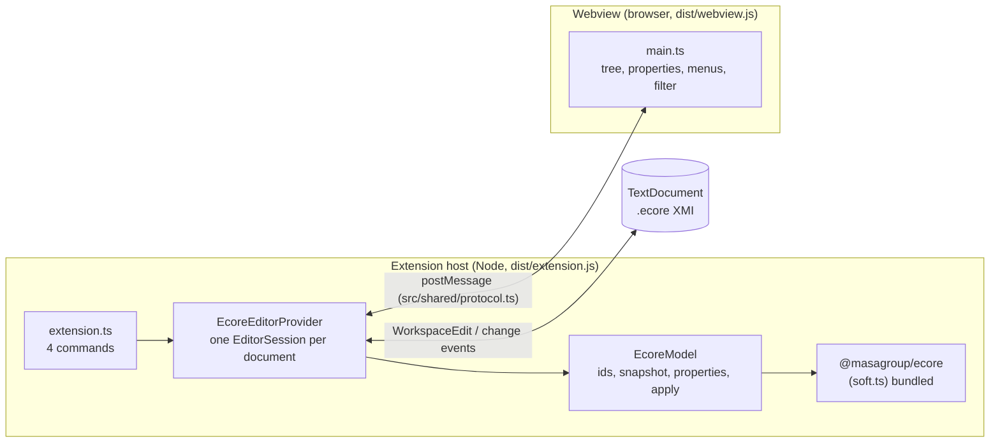
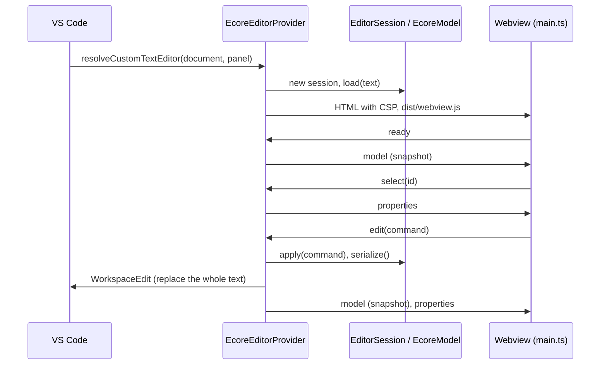
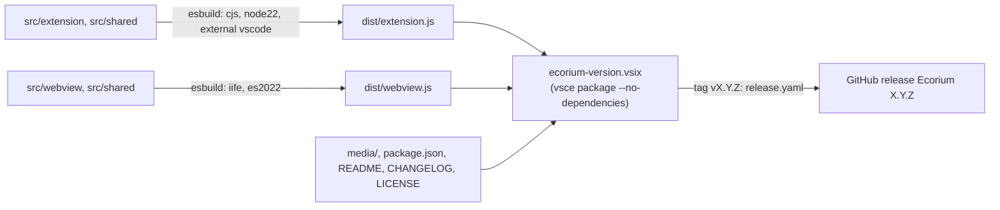

# soft.vscode: architecture

> Technical choices, diagrams and internal structure of `soft.vscode` (Ecorium). Back to the [README](README.md) · [Contributing](CONTRIBUTING.md) · [repository on GitHub](https://github.com/masagroup/soft.vscode)

| | |
|---|---|
| **Family** | Ecore / esync stack |
| **Kind** | VS Code extension (developer tool) |
| **Languages** | TypeScript (about 1,700 lines for the extension host, about 1,150 for the webview, about 140 shared), CSS (about 640 lines), Node scripts |
| **Remote / branch** | github.com/masagroup/soft.vscode, default branch `master` |
| **Generation** | shared (a tool of the soft.* chain, independent of the old and the next generation of SWORD) |
| **Build systems** | npm scripts · esbuild · `vsce` |

## Overview

The extension has two halves that talk with messages. The extension host (Node) owns the text document and a Soft TS
model of it; the webview (browser sandbox of VS Code) draws the tree and the properties and sends the user's edits back.
The text document stays the single source of truth: every edit is applied to the model, the model is serialized to XMI,
and the XMI replaces the text of the document through a `WorkspaceEdit`.



## Position in the ecosystem

Ecorium is a tool for the people who write `.ecore` metamodels. It is not shipped with SWORD and it talks to no other
application: it reads and writes files. See the transverse wiki pages [Ecore models, code generation and esync](https://github.com/masagroup/wiki/wiki/esync-ecore)
and [Ecosystem next gen](https://github.com/masagroup/wiki/wiki/ecosystem-nextgen).

| Concern | Status | Evidence |
|---|---|---|
| ecore model | Edits `.ecore` files with the TypeScript Ecore runtime [soft.ts](https://github.com/masagroup/soft.ts); the metamodels of the soft.* chain ([soft.models](https://github.com/masagroup/soft.models), `sw.api.ng`) are `.ecore` files, which Ecorium can open (UNVERIFIED on the large models of `sw.api.ng`) | `package.json` (`@masagroup/ecore`), `src/extension/model/ecoreModel.ts` |
| code generation | Upstream of the generator: the `.ecore` file saved by Ecorium is the input of [soft.gen](https://github.com/masagroup/soft.gen); nothing calls it from this repository | repository structure |
| esync | Not used: no dependency on `@masagroup/esync`, no network code | `package.json` |
| gateway, history, dos, authentication, node, orchestrator, commander, hub, recorder, timeline, mapserver, datacore, dispatcher, HLA | Unrelated (no mention in code, build or CI) | repository structure |

## Repository layout

```
soft.vscode/
├── .github/workflows/
│   ├── build_and_test.yaml     typecheck, test, build, package; also called by release.yaml
│   └── release.yaml            tag vX.Y.Z -> GitHub release with the VSIX
├── .vscode/                    launch.json ("Run Ecorium"), tasks.json (npm: compile)
├── media/                      icon.png (extension icon), webview.css (webview styles)
├── samples/                    library.ecore, tournament.ecore (opened by F5), .vscode/settings.json (auto save off)
├── scripts/
│   ├── harness.mjs             webview in a plain browser against the model layer in Node
│   └── make-icon.mjs           generates media/icon.png without native dependency
├── src/
│   ├── extension/
│   │   ├── extension.ts            activate(): registers the commands and the editor provider
│   │   ├── ecoreEditorProvider.ts  custom text editor provider, EditorSession, webview HTML
│   │   └── model/
│   │       ├── ecoreModel.ts       EcoreModel: Soft TS model of one document (about 990 lines)
│   │       ├── labels.ts           icons, labels and default names of the tree
│   │       └── xmiLocator.ts       finds the start tag of an element in the XMI text
│   ├── shared/protocol.ts          messages and data types exchanged by host and webview
│   └── webview/main.ts             the editor UI (about 1,150 lines, no framework)
├── test/                       vitest: ecoreModel.test.ts, extension.test.ts, vscode.stub.ts, fixtures/
├── esbuild.mjs                 the two bundles
├── package.json                manifest (contributes, activation, scripts) and dependencies
├── tsconfig.json               extension, shared and tests
├── tsconfig.webview.json       webview and shared (DOM lib)
├── vitest.config.ts            aliases `vscode` to test/vscode.stub.ts
├── CHANGELOG.md, LICENSE, .npmrc, .vscodeignore, .prettierrc
└── README.md, ARCHITECTURE.md, CONTRIBUTING.md
```

## Architecture

| Module | Role |
|---|---|
| `extension.ts` | `activate()` creates the provider and registers `ecorium.openWithEcorium`, `ecorium.openAsText`, `ecorium.reload` and `ecorium.newModel`. `newModel` asks for a location and writes a one-package XMI template whose name is derived from the file name. |
| `ecoreEditorProvider.ts` | `EcoreEditorProvider` implements `CustomTextEditorProvider` for the view type `ecorium.ecoreEditor` (`retainContextWhenHidden`, `supportsMultipleEditorsPerDocument`). `EditorSession` (one per document, shared by all its panels) holds the `EcoreModel`, the pending selection, the text it wrote last and a 250 ms reload timer. It also registers the `ecorium-package` document provider, the `ecorium` diagnostic collection and the configuration listener. |
| `model/ecoreModel.ts` | `EcoreModel` wraps an `EResourceSet` of Soft TS: loads and serializes the XMI, gives every object a session-stable id (`o1`, `o2`...) re-attached by URI fragment after a reload, builds the tree snapshot, the property descriptors and the "New Child" options from the Ecore metamodel itself, applies the `EditCommand`s and manages the external packages. |
| `model/labels.ts`, `model/xmiLocator.ts` | EMF-like labels, icons and default names; location of an element's start tag in the XMI text (the n-th child element named after the containment feature), used by `Open as Text`. |
| `shared/protocol.ts` | The only contract between the halves: `HostMessage` (`model`, `properties`, `error`), `WebviewMessage` (`ready`, `select`, `edit`, `openText`, `openExternal`, `addPackage`, `removePackage`) and `EditCommand` (`set`, `setMany`, `setRef`, `setRefs`, `create`, `delete`, `move`). |
| `webview/main.ts` | Plain TypeScript and DOM, no framework and no import of Soft TS (types only): tree, filter, properties editors, context menu, keyboard, external packages panel. Expansion, selection and widths are kept with `vscode.setState`. |

Sensitive points:

- **Round trip**: the model is re-serialized on each edit, and the whole document text is replaced. The model is read-only
  (`isReadOnly()`) while the text cannot be parsed, while Soft TS reported an error while loading it, or for a built-in
  package; the last good model is kept while the text is broken.
- **Webview security**: the page has a Content-Security-Policy (`default-src 'none'`, scripts only with a nonce, styles from the
  extension, images from the extension or `data:`), scripts enabled, and `localResourceRoots` limited to `dist` and `media`.
- **Platform paths**: Soft TS URIs of files are built as `file:///<path>` whatever the platform (`fileUri()` in
  `ecoreEditorProvider.ts`), so cross-file references resolve the same on Windows and Linux.

## How it works

### Open and edit



1. VS Code opens a `.ecore` file in the custom editor; the provider creates (or reuses) the session of the document and
   serves the webview page.
2. The webview sends `ready`; the host answers with the tree snapshot. Selecting a node asks for its properties.
3. An edit reaches `EcoreModel.apply`, then the XMI is written back with a `WorkspaceEdit` (with the document's end of line
   kept). Undo, redo, save and hot exit are therefore the ones of the text document.
4. A text change that is not the one just written (typing in the XML editor, git checkout, undo) is re-parsed after 250 ms
   and broadcast to every panel of the document; comparison ignores the end of line.

### Navigation and external packages

`Ctrl+Click` on a type sends `openExternal` with `<resource uri>#<fragment>`. A `file:` resource opens in Ecorium and the
fragment is selected once the target editor is ready; a package registered in Soft TS (Ecore itself) opens as a read-only
document of scheme `ecorium-package` whose content is the serialized package. The external packages panel lists the
resources the document points to plus the files added with `+` (`addPackage`); `removePackage` is refused while an element
points into the package. `Reload Model` drops the cached resource set so changed referenced files are read again.

### From sources to artifacts



Soft TS and its own dependencies are bundled into `dist/extension.js`, which is why the VSIX is built with
`--no-dependencies`. The production build (`npm run build`, run by `vscode:prepublish`) minifies both bundles; the
development one (`npm run compile`) adds source maps. CI and release are described in [CONTRIBUTING.md](CONTRIBUTING.md#cicd).

## Dependencies

### Internal (MASA repositories)

| Repository | How it is pulled | What for |
|---|---|---|
| [soft.ts](https://github.com/masagroup/soft.ts) | npm `@masagroup/ecore` `^1.8.0` from GitHub Packages (`@masagroup:registry=https://npm.pkg.github.com` in `.npmrc`; locked at 1.8.0) | EMF core: resources, XMI codec, Ecore metamodel, notifications |

No `<update>` / `<update-gh>` (no Ant), no `FROM masagroup/*` (no Dockerfile), no submodule, no `go.mod`. The shared
`masagroup/cicd` workflows are not used: the two workflows of the repository are standalone. The `homepage` of
`package.json` is the [soft](https://github.com/masagroup/soft) umbrella repository.

### External

| Package | Version | Use |
|---|---|---|
| `vscode` API | `engines.vscode ^1.140.0`, `@types/vscode 1.140.0` | extension API |
| `esbuild` | `^0.28.2` | the two bundles |
| `typescript` | `^7.0.2` | type checking |
| `vitest` | `^5.0.5` | unit tests |
| `@vscode/vsce` | `^4.0.0` | packaging of the VSIX |
| `@types/node` | `^26.6.5` | Node typings of the extension host |

Runtime: the only declared dependency is `@masagroup/ecore`; its own packages (`sax`, `async-mutex`, `id128`, `path-browserify`, `ts-results-es`, per `package-lock.json`) are bundled with it.
